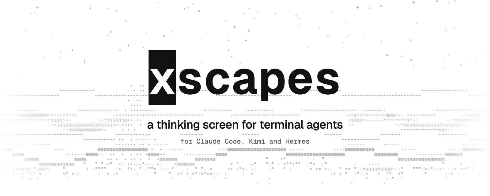
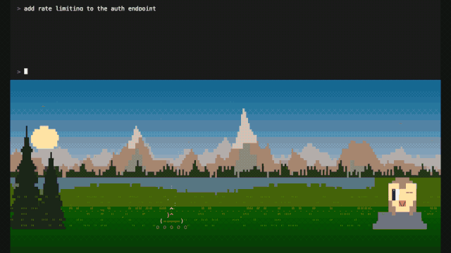
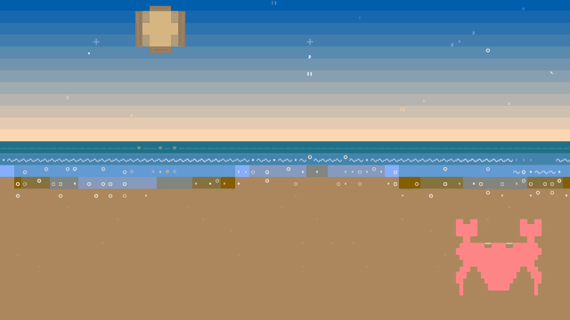
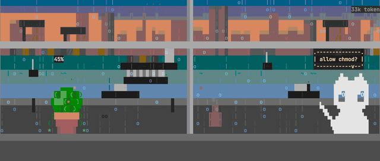
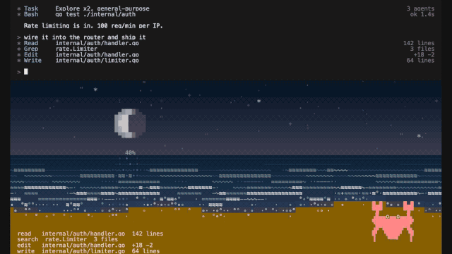

<p align="center">
  
</p>

<p align="center">
  <b>Living ASCII scenes that react as your agent works.</b><br>
  Your agent runs at the top of the window, the scene underneath shows what it is doing, and the companion knocks when it needs you.
</p>

<p align="center"><a href="https://donlucasx.github.io/xscapes">site</a> · <a href="https://donlucasx.github.io/xscapes/manual.html">manual</a> · <a href="https://github.com/donlucasx/hermes-xscapes">hermes plugin</a></p>

## Install

macOS and Linux:

```sh
curl -fsSL https://donlucasx.github.io/xscapes/install.sh | sh
```

Then run your agent inside the scene:

```sh
xscapes install claude --apply && xscapes claude    # Claude Code
xscapes install kimi --apply   && xscapes kimi      # Kimi Code CLI
hermes plugins install donlucasx/hermes-xscapes --enable && xscapes hermes    # Hermes Agent
xscapes inside <any command>                        # anything else
```

`install` without `--apply` only prints what it would change, and `uninstall`
puts your settings back. Every command and option is in the
[manual](https://donlucasx.github.io/xscapes/manual.html).

### Windows

Needs Go 1.27+ and Windows 10 1809 or later (the scene runs the agent on a
pseudoconsole). Build it, then install the hooks — no tmux, no install.sh:

```powershell
go build -o xscapes.exe .
.\xscapes.exe install hermes --apply      # writes hooks into your Hermes profile
.\xscapes.exe hermes                      # then run Hermes inside the scape
.\xscapes.exe inside <any command>        # anything else
```

`install hermes` finds the config your agent actually reads: `$HERMES_HOME`,
else the profile the desktop app runs (`%LOCALAPPDATA%\hermes\profiles\<name>`),
else `%LOCALAPPDATA%\hermes`. Hermes asks for consent the first time each hook
fires; `hermes hooks doctor` answers once for all of them. What the port had to
change, and how each piece was verified, is in
[notes/windows-conpty.md](notes/windows-conpty.md).

## What you see

<table>
  <tr>
    <td width="50%"><br><b>The vista.</b> The wind and the fire are the work. Owlets arrive for subagents.</td>
    <td width="50%"><br><b>The shore.</b> The sea rises with the work, and the sand says what it is doing.</td>
  </tr>
  <tr>
    <td><br><b>The harbour.</b> Rain on the window is the work. A thought cloud means it is thinking.</td>
    <td><br><b>It needs you.</b> The companion walks up and asks, with its own sound.</td>
  </tr>
</table>

The moon is your context and sinks as it fills. Finished todos light up as
stars. The sky follows your clock. Switch with `xscapes scape vista|shore|harbour`
and `xscapes companion crab|cat`.

## The protocol

Each agent's adapter turns its hooks into a small set of events, and any
program that sends them can drive a scene:

```
session_start  prompt  tool_start  tool_end  error  test_pass  test_fail
sub_start  sub_end  needs_input  done  compact  context  todo  session_end
```

```sh
xscapes emit needs_input -text "allow Bash?"
```

## Code

Go, standard library only, one static binary. `go test ./...` runs the tests.
MIT.
