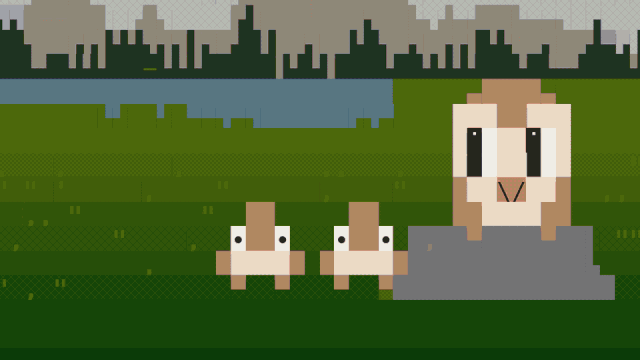
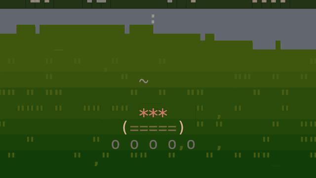
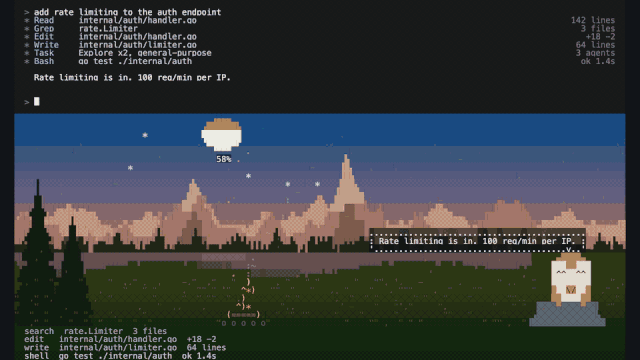
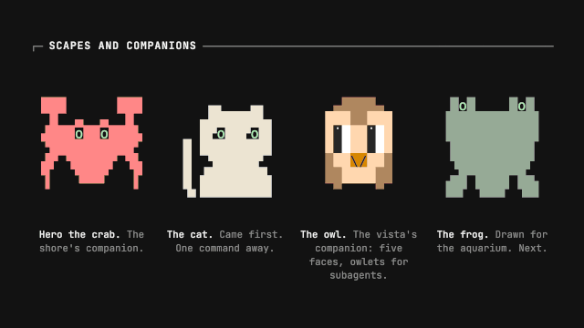

<p align="center">
  
</p>

<p align="center">
  <b>Your agent works in the top of the window. A small living scene underneath shows what it is doing.</b><br>
  The tide rises while it works, the sand records what it did, and the companion knocks when it needs you.
</p>

```sh
curl -fsSL https://donlucasx.github.io/xscapes/install.sh | sh
xscapes install claude --apply && xscapes claude
```

<p align="center"><a href="https://donlucasx.github.io/xscapes">site</a> · <a href="https://donlucasx.github.io/xscapes/manual.html">manual</a> · <a href="#install">install</a> · <a href="#what-you-are-looking-at">how to read it</a> · <a href="#the-protocol">the protocol</a></p>

## Why

You send a prompt, the terminal goes quiet, you tab away and forget to come
back. xscapes draws the wait. The agent's real hook events drive everything on
screen, and each element means one thing, so a glance from across the room is
enough.

<table>
  <tr>
    <td width="50%"><br><b>The shore.</b> The sea rises with the work. What the agent is doing now is written in the sand.</td>
    <td width="50%"><br><b>It needs you.</b> The crab walks up to the glass and asks, with its own sound. A finish sounds different.</td>
  </tr>
  <tr>
    <td><br><b>The mountain vista.</b> The wind and the fire are the work. The sky follows your clock.</td>
    <td><br><b>Subagents</b> arrive as owlets on the mountain and crablets on the shore, and leave when they finish.</td>
  </tr>
  <tr>
    <td><br><b>The fire</b> goes from still air to a blaze with the work. The moon is your context: it wanes and sinks as the window fills.</td>
    <td><br><b>Night falls</b> when yours does. Finished todos light up as stars.</td>
  </tr>
  <tr>
    <td><br><b>The harbour.</b> Rain on the window is the work, a thought cloud over the cat means it is thinking, and kittens climb onto the sill for subagents (<code>xscapes scape harbour</code>).</td>
    <td><br><b>Companions.</b> The crab and the cat ship today (<code>xscapes companion cat</code>), the owl lives on the vista, and the frog is next.</td>
  </tr>
</table>

It works with **Claude Code, Kimi Code CLI and Hermes Agent** through their
hooks, and with any other terminal program through a generic watcher
(`xscapes inside <cmd>`). macOS and Linux, one Go binary, MIT.

Underneath is an **event protocol** with pluggable adapters, so any agent can
drive it. The **scapes** are what that protocol looks like with a sea and a
crab, or a mountain and an owl.

## Install

On a Mac or Linux, with or without Go:

```sh
curl -fsSL https://donlucasx.github.io/xscapes/install.sh | sh
```

Then connect your agent and run it inside the scape:

```sh
xscapes install claude --apply && xscapes claude    # Claude Code
xscapes install kimi --apply   && xscapes kimi      # Kimi Code CLI
hermes plugins install donlucasx/hermes-xscapes --enable && xscapes hermes    # Hermes Agent
xscapes inside <any command>                        # anything else, no hooks
```

Run it from the project you are working in, not from this repo. It needs
nothing else installed.

- `xscapes install <agent>` without `--apply` prints the plan and writes
  nothing. With it, the hooks go in after a backup. `uninstall` removes
  exactly what was written and restores your settings byte for byte.
- The launcher won't start until the agent's hooks are all installed
  (hooks you wrote by hand count), and prints the install line instead.
  `xscapes <agent> -watch=on` runs without hooks on the output watcher, which
  sees work and prompts but not tool names, asks or subagents.
- The script puts the binary in `~/.local/bin`, adds it to your PATH if
  needed, and prints the next commands. It is short:
  [site/install.sh](site/install.sh).
- To build it with Go: `GOBIN=~/.local/bin go install github.com/donlucasx/xscapes@latest`
  (plain `go install` uses `~/go/bin`, which is not on a Mac's PATH).
- Windows is not supported natively, because the agent runs on a Unix
  pseudo-terminal. WSL should work as Linux but is untested.
- `xscapes claude -beside` is the older side-by-side layout, with the agent
  and the scape in separate tmux panes (`brew install tmux`; without tmux it
  opens a second Terminal window).

### How the agent runs inside the scape

xscapes is not a terminal emulator. It runs the agent on a pty, tells it the
window is only as tall as its band, and pins the band to the top of the screen
with a scroll region. The agent's bytes reach your terminal untouched, so a bug
in xscapes can't corrupt the agent's display.

The band sits at the top because scrolled lines reach your scrollback only when
the scroll region starts at row 1 (in Terminal.app, a region on rows 1-10 keeps
every scrolled line and one on rows 5-14 keeps none). So the scape reads
downward: sky under the agent, then the sea, then the beach, and a taller
window gives the extra rows to the beach.

It runs on the alternate screen, like vim. On the main screen, growing the
window pulls old lines back from history and pushes the agent out of its band,
and the agent never redraws to notice. xscapes keeps your scrollback anyway: it
copies every row that leaves the band into the main buffer, so you can scroll
up through the transcript with your usual wheel, selection and search, and it
prints the transcript and final screen again when the session ends, because
Terminal.app drops that history. Early in a session there are blank rows
between the transcript and the band. `-history=false` turns this off.
`-alt=false` runs on the main screen and brings back the resize problem.

The cost of not being an emulator: the sea does not show through the agent's
blank space.

## What you are looking at

Everything on screen means one thing, and no two things share a channel. On
the shore:

| what | how it reads |
|---|---|
| how hard the agent is working | **the sea**: how many swells, how tall, whitecaps above half |
| what it is doing now | **writing in the sand**, newest brightest, older lines taken by the tide |
| something is broken | **the companion**: claws down, stalks short, amber eyes, until you come back |
| it needs you | **a solid balloon** in a warm colour and a bright chime |
| it finished | **a dotted balloon** in a cool colour and a low sonar note |
| subagents | **crablets**, one per agent, some already in the water |
| context left | **the sun by day, the moon by night**: phase and height, with a number from 40% used |
| time of day | **the sky**, from your clock |

The water is the work and the sky is the world. Sea state always means the
agent, and sky, light and time always mean reality, so you never have to ask
which of two meanings a change carries.

The two knocks differ in shape and colour, so they read in a screenshot and
for colourblind eyes, and in sound, so you hear them from another pane. A
third sound marks a finish that left something broken: the companion is still
worried when the turn ends. Nothing else makes a sound.

## The protocol

Adapters turn an agent into events, and the engine folds events into a scene.
Anything that emits these can drive a scape:

```
session_start  prompt  tool_start  tool_end  error  test_pass  test_fail
sub_start  sub_end  needs_input  done  compact  context  todo  session_end
```

Send one by hand:

```sh
xscapes emit tool_end -tool Read -target internal/auth/handler.go -detail "142 lines"
xscapes emit needs_input -text "allow Bash?"
```

Events reach a running scape over a unix socket in `~/.config/xscapes/run/`.
When nothing is listening they spool to a file, so a scape started late still
picks up the session. Settings come from `XSCAPES_*` (the old `ASCIISCAPES_*`
names still work, with a warning).

- **Claude Code**, through hooks that `xscapes install claude` writes. The
  payload schema was read out of the Claude Code binary
  (`notes/claude-hooks-verified.md`).
- **Any program**, with no hooks: `xscapes inside <command>` treats output as
  work, Enter as a prompt and quiet after work as done. It can't tell a
  question from a finish, so it never plays the ask cue, and the sand shows
  the last line printed instead of tool names. It runs until an agent's hooks
  announce a session; `-watch=on|off` forces it.
- **Kimi Code CLI**, through shell hooks that `xscapes install kimi` appends to
  `~/.kimi-code/config.toml`. Kimi uses Claude Code's event names with
  different payloads, each measured on Kimi (2026-09-17): prompts arrive as
  parts, `TodoList` lights the stars, its permission prompt is the ask, and a
  subagent's finish carries no mark. Esc sends an interrupt instead of a
  finish, and the moon and the token count read Kimi's session files, since
  its hooks name no transcript.
- **Hermes Agent**, through the plugin
  [donlucasx/hermes-xscapes](https://github.com/donlucasx/hermes-xscapes),
  which also forwards questions, password prompts and each model call's token
  usage. The shell hooks (`xscapes install hermes`) still work; use one or the
  other, or every event arrives twice.

Every installer writes only with `--apply`, and every uninstall removes
exactly what it wrote. To add an agent, emit the events above; the engine
knows nothing about any agent.

## Everything else

```sh
xscapes companion crab     # choose the animal: crab (default) or cat
xscapes scape harbour      # choose the scape: vista (default), shore or harbour; a running scape switches
xscapes inside <command>   # host any command inside the scape, not just claude
xscapes install kimi       # Kimi Code CLI hooks (a plan; --apply writes)
xscapes kimi               # Kimi Code CLI inside the scape
hermes plugins install donlucasx/hermes-xscapes --enable   # Hermes Agent, through its plugin
xscapes install hermes     # or Hermes Agent's shell hooks (a plan; --apply writes)
xscapes hermes             # Hermes Agent inside the scape
xscapes claude -beside     # the older side by side layout, in tmux
xscapes claude -scape 24   # give the scape 24 rows (default: eight fifteenths of the window, at most 28)
xscapes claude -fps 8      # slow the scape down
xscapes claude -history=false  # do not mirror the transcript into the terminal's scrollback
xscapes claude -alt=false  # run on the main screen; a resize can then push the agent out of its band
xscapes claude -print      # show how the window splits and what will run; changes nothing
xscapes -live              # the scape in this terminal, Ctrl-C to quit
xscapes -info              # colour profile, size, which sound player
xscapes notify             # hear the three knocks
xscapes replay session.jsonl   # feed a recorded session back through the engine
XSCAPES_COMPANION=cat …    # override the companion for one run, without saving it
XSCAPES_SCAPE=vista …      # override the scape for one run, without saving it
XSCAPES_SILENT=1 …         # mute
XSCAPES_HOOKLOG=file …     # the hook command appends every raw payload and where it went (adapter debugging)
XSCAPES_EVENTLOG=file …    # the scape appends every event its reducer applied (the other end of the same question)
XSCAPES_HOOKLOG=1 …        # =1 picks ~/.config/xscapes/hooks.jsonl (and events.jsonl), like XSCAPES_TRACE=1
                           # ⚠ the hook log holds every payload verbatim: your prompts, commands and paths
```

## Notes for anyone reading the code

Go, standard library only, one static binary. Four things were harder than
they look and are commented where they live:

- **256 colours are not greyscale.** A dark palette collapses to grey because
  the xterm cube has almost no resolution below luma 25. The darkness lives in
  the backgrounds and the colour in the glyphs, the bright part of the frame.
  `XSCAPES_CHROMA` tunes it.
- **Activity is coverage, count and position, never rate.** A screenshot has
  no motion. The first version mapped activity to wave speed, and idle looked
  the same as flat out.
- **The renderer is a three-layer alpha compositor**, so occlusion between the
  companion, the crablets and the sea is decided once, not per sprite.
- **The host keeps its own copy of the screen.** The agent's bytes still reach
  the terminal untouched, but the host also feeds them through a small terminal
  model, so it knows which rows left the band and what was in them. That copy
  is what goes into your scrollback, and what the resize tests replay a real
  session through.

`go test ./...` runs the tests. The interesting ones catch things that looked
fine on screen and weren't: whiskers that must touch fur on their own row, a
sixty-second permission nag that must ring once rather than every minute, and
a killed agent that must settle instead of leaving the companion working
forever.

## Status

Three scapes ship (the mountain vista with the owl, the shore with the crab,
the harbour with the cat), with adapters for Claude Code, Kimi Code CLI and
Hermes Agent. Next: the aquarium with the frog, and Codex CLI, Gemini CLI and
OpenCode.

## License

MIT.
